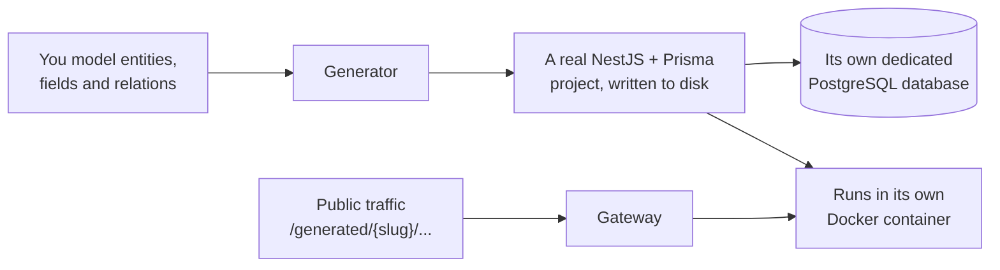

# BackOS

**A backend generator.** Describe your data in a web interface, and BackOS builds, runs and serves a complete NestJS + Prisma backend for it — with its own database, its own routes, and its own isolation.

> **New here?** Read [What is BackOS?](#1-what-is-backos), then jump straight to [Get the project on your machine](#4-get-the-project-on-your-machine) and [Choose how to run it](#5-choose-how-to-run-it).

---

## Table of contents

1. [What is BackOS?](#1-what-is-backos)
2. [Technology stack](#2-technology-stack)
3. [Repository map](#3-repository-map)
4. [Get the project on your machine](#4-get-the-project-on-your-machine)
5. [Choose how to run it](#5-choose-how-to-run-it)
6. [Scheduled cleanup](#6-scheduled-cleanup)
7. [Where to go next](#7-where-to-go-next)

---

## 1. What is BackOS?

BackOS is **not** a classic business API. It is a **backend generator**: a "meta" system that writes and runs code on behalf of its users.

### How it works



1. **Model** — in the interface, you create entities (tables), fields (columns) and relations.
2. **Generate** — the `generator` module turns that model into a real NestJS + Prisma project on disk, with its own CRUD routes and its own PostgreSQL database.
3. **Run** — each generated backend starts in its own isolated Docker container, with its own network and CPU/memory limits.
4. **Serve** — the `gateway` module routes public traffic from `/generated/<slug>/...` to the right generated backend.

Around that core, BackOS also provides user and role management, clients and projects, planning, internal messaging, file uploads, backups and an audit log (see the [repository map](#3-repository-map)).

### Security by design

Because the system generates and executes code, its attack surface is larger than a conventional CRUD application. The architecture accounts for this:

- **Per-platform network isolation** — each platform runs on its own network.
- **Restricted `docker-socket-proxy`** — Docker is driven through a proxy that only exposes what the orchestrator needs.
- **Dedicated PostgreSQL user for each platform** — each generated backend has its own database credentials.
- **Loopback-only generated backends** — they are reachable only through the gateway, never directly. See [`src/gateway/GATEWAY_README.md`](src/gateway/GATEWAY_README.md).
- **Authentication hardening** — JWT with rotating refresh tokens, brute-force protection and optional MFA (TOTP).

---

## 2. Technology stack

| Layer                       | Choice                                                                                 |
| --------------------------- | -------------------------------------------------------------------------------------- |
| Backend framework           | NestJS 11                                                                              |
| ORM / Database              | Prisma 7 + PostgreSQL 16                                                               |
| Queue / Cache               | BullMQ + Redis 7                                                                       |
| Authentication              | JWT (access + rotating refresh tokens), optional MFA/TOTP                              |
| Public reverse proxy        | Traefik (automatic Let's Encrypt TLS)                                                  |
| Generated backend isolation | One dedicated Docker container per generated backend                                   |
| CI/CD                       | GitHub Actions (lint, build, tests, `pnpm audit`, Gitleaks, Trivy, CodeQL, Dependabot) |

---

## 3. Repository map

Everything lives under [`src/`](src/). Each row links to the code, so you can open the part you are curious about.

| Domain                        | Folder(s)                                                                                                                                  | What it does                                                                                                             |
| ----------------------------- | ------------------------------------------------------------------------------------------------------------------------------------------ | ------------------------------------------------------------------------------------------------------------------------ |
| **Authentication & security** | [`auth/`](src/auth/), [`common/guards/`](src/common/guards/), [`common/services/`](src/common/services/)                                   | Login, token refresh, brute-force protection, MFA / TOTP, encryption helpers                                             |
| **Authorization**             | [`permissions/`](src/permissions/), [`roles/`](src/roles/)                                                                                 | Role-based access control, kept in sync with the database                                                                |
| **Users**                     | [`users/`](src/users/)                                                                                                                     | Accounts, roles assignment, status lifecycle, data export, anonymization and deletion                                    |
| **Modeling**                  | [`entities/`](src/entities/), [`fields/`](src/fields/), [`relations/`](src/relations/), [`enum-definitions/`](src/enum-definitions/)        | What a user models for their backend: tables, columns, relations and enums                                               |
| **Generation** ⭐             | [`generator/`](src/generator/)                                                                                                             | The core of the product: dynamic Prisma schema, generated CRUD, database provisioning, runtime orchestration, API manifest |
| **Platform lifecycle**        | [`platforms/`](src/platforms/)                                                                                                             | Create, archive, restore and permanently delete platforms; members and per-platform roles                                |
| **Public gateway**            | [`gateway/`](src/gateway/)                                                                                                                 | Routes `/generated/<slug>/...` to the right generated backend — see [`GATEWAY_README.md`](src/gateway/GATEWAY_README.md)   |
| **Management**               | [`clients/`](src/clients/), [`projects/`](src/projects/), [`planning/`](src/planning/), [`messages/`](src/messages/)                       | Clients and contracts, projects, planning (personal or per platform, with recurring programs) and internal messaging      |
| **Files**                     | [`files/`](src/files/)                                                                                                                     | Uploads, validated on both the declared MIME type **and** the real binary signature (magic bytes)                        |
| **Backups**                   | [`backup/`](src/backup/)                                                                                                                   | Database dumps and automatic cleanup of unclaimed files                                                                  |
| **Scheduled cleanup**         | [`cleanup/`](src/cleanup/)                                                                                                                 | Daily maintenance task — see [§6](#6-scheduled-cleanup)                                                                  |
| **Audit**                     | [`audit/`](src/audit/)                                                                                                                     | Log of sensitive actions                                                                                                 |
| **Email**                     | [`email/`](src/email/)                                                                                                                     | Notifications: invitations, one-time codes, alerts                                                                       |

---

## 4. Get the project on your machine

### Before you start

You only need **[Git](https://git-scm.com/downloads)** to download the project. Check that it is installed:

```bash
git --version
```

Any extra tool needed to *run* BackOS (a container runtime, a domain name, …) depends on the deployment mode you pick in the next step, and is listed in the matching guide.

### Step by step

**1. Open a terminal** in the folder where you keep your projects.

**2. Clone the repository:**

```bash
git clone https://github.com/D-Protocol-Sys/BackOS-API
```

**3. Move into the project folder:**

```bash
cd BackOS-API
```

**4. Check that you are in the right place.** You should see the `src/` folder and the `docs/` folder:

```bash
ls
```

> **No Git?** On the GitHub page of the repository, click **Code → Download ZIP**, extract it, and open a terminal in the extracted folder.

✅ **You now have BackOS on your machine.** Nothing is running yet — the next section explains how to start it.

---

## 5. Choose how to run it

Once you have the project, you can run it in **several ways**, depending on what you want to do with it. Each way is called a *deployment mode* and has its own step-by-step guide.

> 👉 **Start with the [overview of the deployment guides](docs/deployments/README.md).** It compares the modes and gathers what they all share.

> [!IMPORTANT]
> **Everything runs in Docker containers**, in every mode: the BackOS API, its database, and each generated backend. **Docker is the only tool you need to install** (plus Git to download the project).

### Which guide is for me?

| I want to…                                                           | Follow                                                                                                    |
| -------------------------------------------------------------------- | --------------------------------------------------------------------------------------------------------- |
| Try BackOS, or work on its code, on my own machine                   | [Development](docs/deployments/DEPLOIEMENT_DEV.md)                                                        |
| Run a stable private instance at home or in the office               | [LAN](docs/deployments/DEPLOIEMENT_LAN.md)                                                                |
| Show the project to someone, safely                                  | [Demo](docs/deployments/DEPLOIEMENT_DEMO.md)                                                              |
| Put BackOS online for real users                                     | [Production](docs/deployments/DEPLOIEMENT_PRODUCTION.md)                                                  |
| Reach a private instance from outside, without exposing it           | [WireGuard](docs/deployments/DEPLOIEMENT_WIREGUARD.md)                                                    |
| Do several of the above on **one single machine**                    | [Combined deployments](#combined-deployments)                                                             |

> Not sure? Start with **Development**. It is the quickest way to see BackOS working, and nothing is exposed to the network.

### Single deployment modes

All guides are in [`docs/deployments/`](docs/deployments/). Each one is step by step, with checks after the important actions, and a troubleshooting table.

| Mode                                                          | What it covers                                                                                 | Intended use                                |
| ------------------------------------------------------------- | ---------------------------------------------------------------------------------------------- | ------------------------------------------- |
| [**Development**](docs/deployments/DEPLOIEMENT_DEV.md)        | Your own machine, everything in Docker containers, started with a single command               | Trying BackOS and developing on it          |
| [**LAN**](docs/deployments/DEPLOIEMENT_LAN.md)                | A stable private instance on a local network, controllable from a Windows system-tray icon     | Personal or internal use, no public domain  |
| [**Demo**](docs/deployments/DEPLOIEMENT_DEMO.md)              | A public instance with a **read-only** account                                                 | Presentations and client demos              |
| [**Production**](docs/deployments/DEPLOIEMENT_PRODUCTION.md)  | A full public instance                                                                         | Official, real-world deployment             |
| [**WireGuard**](docs/deployments/DEPLOIEMENT_WIREGUARD.md)    | A self-hosted encrypted VPN tunnel to reach a private instance remotely                        | Remote access without public exposure       |

> 📜 *Historical note:* [`DEPLOIEMENT_INTERNE_TAILSCALE.md`](docs/deployments/DEPLOIEMENT_INTERNE_TAILSCALE.md) describes an alternative to WireGuard that was **rejected** (it relies on a third party). It is kept only to explain why.

### Combined deployments

Need more than one mode but only have **one machine**? These guides show how to make several modes coexist. All of them are in [`docs/deployments/combines/`](docs/deployments/combines/).

| Combination                                                                                                              | What you get                                                      | Use case                                                                                  |
| ------------------------------------------------------------------------------------------------------------------------ | ----------------------------------------------------------------- | ----------------------------------------------------------------------------------------- |
| [**LAN + Demo + WireGuard**](docs/deployments/combines/DEPLOIEMENT_COMBINE_LAN_DEMO_WIREGUARD.md)                         | LAN (with tray icon), a public demo and a VPN, on a single machine | One server PC: a protected private instance **and** a public demo                         |
| [**Demo + Production**](docs/deployments/combines/DEPLOIEMENT_COMBINE_DEMO_PRODUCTION.md)                                 | Both instances behind the same Traefik                            | A public demo and the real production instance on one server                              |
| [**Production + WireGuard**](docs/deployments/combines/DEPLOIEMENT_COMBINE_PRODUCTION_WIREGUARD.md)                       | Public production, with admin access through the VPN              | Keep production public for users while protecting administrative and debug access         |

---

## 6. Scheduled cleanup

A task runs **every day at 3:00 AM** (see [`src/cleanup/`](src/cleanup/)) to keep the system tidy. It deletes, in order:

| What                                                  | Kept for (default)                                    |
| ----------------------------------------------------- | ----------------------------------------------------- |
| Expired invitations and one-time codes (OTPs)         | 7 days                                                |
| Revoked or expired refresh tokens                     | 30 days                                               |
| Consumed MFA recovery codes (unused ones are kept)    | 30 days                                               |
| Finished generation records (success or failed)       | 30 days — running generations are never touched       |
| Old database backup dumps                             | see the backup configuration                          |
| Archived **platforms**, **clients** and **contracts** | 30 days after archiving, then deleted permanently     |
| Orphan uploads (files with no database record)        | files older than 24 hours                             |

Every retention window can be changed through an environment variable (for example `PLATFORM_ARCHIVE_RETENTION_DAYS`).

---

## 7. Where to go next

| You want to…                                          | Go to                                                                    |
| ----------------------------------------------------- | ------------------------------------------------------------------------ |
| Run the project                                       | [Choose how to run it](#5-choose-how-to-run-it)                          |
| Compare the deployment modes                          | [Deployment guides overview](docs/deployments/README.md)                 |
| Automate builds and deployments with GitHub Actions   | [CI/CD guide](docs/deployments/CI_CD.md)                                 |
| See what is tested, and what is not                   | [Tests coverage audit](docs/TESTS_COVERAGE_AUDIT.md)                     |
| Understand how `/generated/<slug>/...` routing works  | [`src/gateway/GATEWAY_README.md`](src/gateway/GATEWAY_README.md)         |
| Explore the API interactively                         | Swagger UI at `/api/docs` (available **outside** production only)        |
| Know which port it listens on                         | `PORT` environment variable — `4803` by default                          |
| Check that an instance is alive                       | `GET /api/health` (answers `503` when the instance is degraded)          |
| Read the code of a given domain                       | [Repository map](#3-repository-map)                                      |
